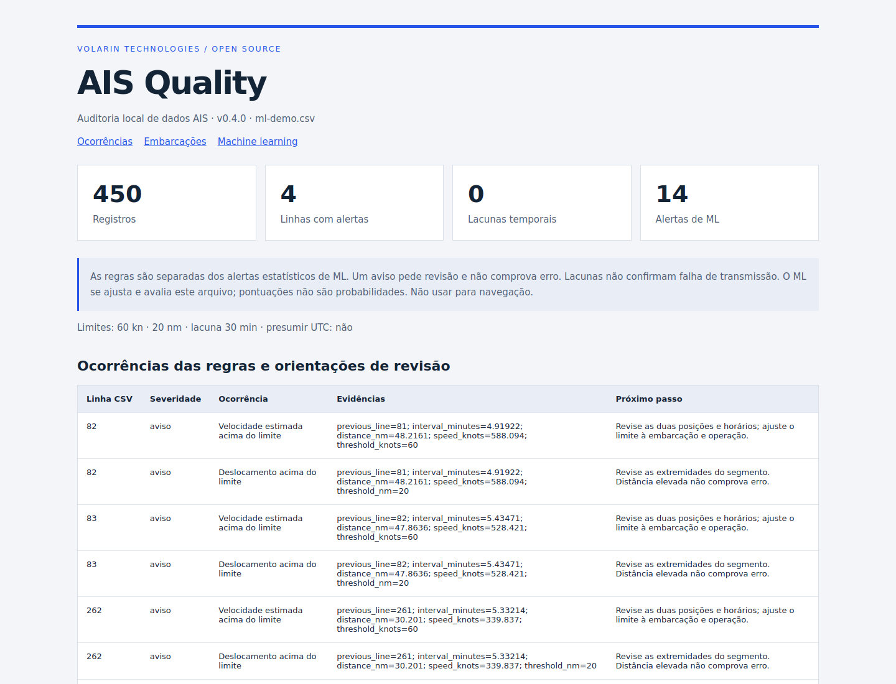

# AIS Quality

**Local AIS data auditing with transparent rules and optional machine learning.**

An open-source project by **Volarin Technologies**. Version **0.4.0 · beta**. Inspect CSV vessel observations before using them in maritime analytics. No server, account, API key or paid service is required at runtime.

[Português](README.pt-BR.md) · [Methodology](docs/METHODOLOGY.md) · [Validation](docs/VALIDATION.md) · [Contribute](CONTRIBUTING.md)



## Start without installing anything

Python 3.10+. Download and extract the project, enter its directory and run:

```bash
python3 ais_quality.py examples/sample.csv --language en --output reports
```

Open `reports/report.html` in a browser. No Python dependencies are required in basic mode. Data stays on your computer.

## Install the CLI

```bash
python3 -m venv .venv
source .venv/bin/activate
python3 -m pip install .
ais-quality examples/sample.csv --output reports
```

On Windows, activate with `.venv\Scripts\activate`. To enable optional ML:

```bash
python3 -m pip install '.[ml]'
ais-quality examples/ml-demo.csv --ml --contamination 0.03 --language en --output reports-ml
```

Dependency installation requires internet. Later execution is offline. ML fits an Isolation Forest to the input file; there is no pretrained maritime model or LLM.

## Checks and outputs

| Check | What it identifies |
| --- | --- |
| Schema and shape | Missing/duplicate headers, incorrect column counts |
| Required values | Missing MMSI, timestamp, latitude or longitude |
| Identifiers | Invalid nine-digit MMSI structure (no registry lookup) |
| Coordinates | Non-numeric, nonfinite or out-of-range positions |
| Timestamps | Invalid dates or missing timezone |
| Duplicates | Exact duplicate across all input columns |
| Position conflicts | Different positions for the same MMSI and normalized UTC timestamp |
| Temporal gaps | Intervals above the configured threshold per vessel |
| Movement | Estimated speed or displacement above user-configured limits |
| Optional ML | Unusual combinations of interval, distance, speed and changes in movement |

Every rule finding includes a stable code, severity, evidence and a review recommendation. Warnings request review; they are not confirmed errors. Temporal gaps and ML alerts are separate from rule findings.

| Output | Contents |
| --- | --- |
| report.html | Responsive report in English or Portuguese; first 500 rows per section |
| report.json | Complete results, settings and ML metadata |
| issues.csv | All rule findings with evidence and guidance |
| flagged_records.csv | One row per flagged source record, canonical values, original record JSON |
| vessels.csv | Per-MMSI record counts, flagged rows, times and gaps |
| ml_segments.csv | All eligible scored ML segments, scores and flags (header-only when not scored) |

Reports replace these filenames in the chosen output folder. Other files remain. Outputs are staged before replacement; each file is replaced atomically, but the set is not a single transaction. The CLI refuses to overwrite its input. CSV field values with spreadsheet formula prefixes are escaped with an apostrophe; JSON preserves original values. Negative coordinates may therefore appear as text in the review CSV.

## Input and options

UTF-8 CSV, optional BOM, decimal degrees with a decimal point. Four canonical fields:

```csv
mmsi,timestamp,lat,lon
999000001,2026-01-01T12:00:00Z,-23.95,-46.30
```

| Field | Case-insensitive aliases (surrounding header spaces ignored) |
| --- | --- |
| mmsi | mmsi, vessel_mmsi |
| timestamp | timestamp, BaseDateTime, base_date_time, datetime, time |
| lat | lat, latitude |
| lon | lon, longitude, lng |

Extra columns are retained for flagged records. Ambiguous aliases are rejected. Explicit mappings reference exact original headers:

```bash
ais-quality data.csv --column timestamp=RecordedAt --column lat=Y --column lon=X --delimiter ';'
ais-quality data.csv --gap-minutes 30 --max-speed-knots 60 --max-jump-nm 20 --language pt
```

Timestamps normally require ISO 8601 with timezone. **Only when the provider documents UTC**, use `--assume-utc` for timestamps without offsets. NOAA's data dictionary documents BaseDateTime as UTC:

```bash
ais-quality examples/real-noaa.csv --assume-utc --ml --output reports-noaa
```

Default safeguards: **100,000 rows / 100,000,000 input bytes**. Exceeding either limit stops analysis. Raise them explicitly only if sufficient memory is available:

```bash
ais-quality data.csv --max-rows 200000 --max-bytes 200000000
```

Exit codes: 0 = analysis completed (findings may exist), 2 = input/configuration/output error. `--version` prints the release. `--help` lists options.

## Evidence and limits

- Included real fixture: first 5,000 records from NOAA MarineCadastre, January 1, 2024; source, CC0 catalog link, extraction method and SHA-256 are recorded in `examples/real-noaa.provenance.json` and [SOURCES.md](SOURCES.md).
- Synthetic ML evaluation: three seeds, clean and injected trajectories, three sensitivities. Results include false positives; [validation details](docs/VALIDATION.md) distinguish in-file detection from held-out accuracy.
- Base benchmark: 10k, 50k and 100k valid synthetic records, including exports. This is an in-memory auditor, not a streaming service. Results are environment-specific.
- Neither rule checks nor ML prove true vessel position, transmitter failure, fraud, spoofing or intent. No navigation use, vessel registry verification, real-time tracking or automatic data correction.
- Published reports can expose source data. Review them before sharing proprietary datasets. The bundled real fixture is separately attributed; code is MIT.

## Develop and contribute

```bash
python3 -m unittest discover -s tests -v
python3 tools/evaluate_ml.py > docs/ml-evaluation.json
python3 tools/benchmark.py > docs/benchmark.json
```

ML tests skip without its optional dependency. GitHub Actions is configured for Python 3.10/3.12/3.13 in base and ML modes; the workflow executes after the repository is published. See [CONTRIBUTING.md](CONTRIBUTING.md), [CHANGELOG.md](CHANGELOG.md) and [release checklist](docs/RELEASE.md).

**License:** MIT for code. NOAA sample: dataset catalog lists CC0; see SOURCES.md. No agency endorsement is implied.
